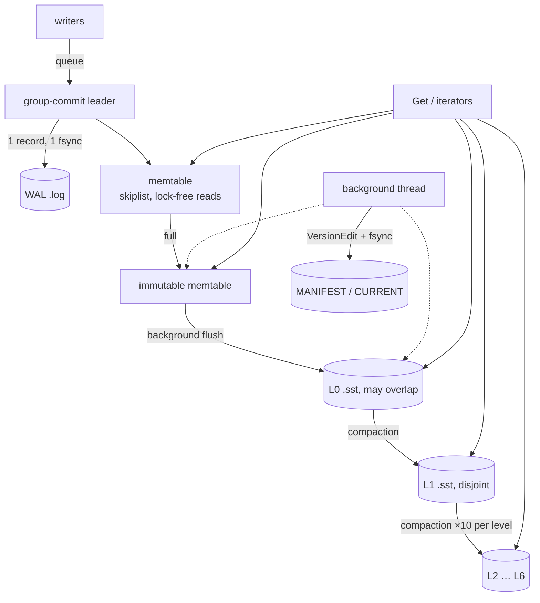

# sedimentdb

An embeddable, crash-safe LSM-tree key-value store in C++20. It has a write-ahead log with group commit, bloom-filtered SSTables, background leveled compaction and snapshot reads. Its durability claim is checked by repeatedly `kill -9`'ing a writer process.

[](https://github.com/eshaan2418/sedimentdb/actions/workflows/ci.yml)
[](LICENSE)


## Why this exists

LSM trees sit under RocksDB, Cassandra, CockroachDB and most modern storage engines, but production code bases are hundreds of thousands of lines. sedimentdb covers the full core design in about 2,700 lines that read top to bottom: WAL, memtable, SSTables, MANIFEST, compaction and snapshots. It treats crash safety as the hard requirement. Every write acknowledged with `sync=true` has to survive a `SIGKILL` at any moment, including mid-compaction, and a test harness checks exactly that on every CI run. On an M5 Pro it performs roughly on par with LevelDB, and is faster on lookups of keys that don't exist.

## Highlights

- **Crash safety, tested by killing a process.** `sediment-crashtest` runs a writer process that acknowledges each `sync=true` write over a pipe. A second thread keeps flushes and compactions in flight, then the process is `SIGKILL`ed at a random moment and the database reopened. In the recorded run (`bench/results/crashtest.txt`), 30 rounds verified 2,069 acknowledged writes with zero losses, while data was spread across L0, L1 and L2.
- **Group commit.** Concurrent writers are merged into one WAL record and one `F_FULLFSYNC`. A sync write never rides along with a non-sync group, and the sequence number is published only after the memtable insert, so snapshots never see half-applied groups.
- **Readers never wait on compaction.** Versions are immutable, and each owns its memory-mapped tables. An iterator opened before a compaction keeps reading its files after compaction unlinks them (tested).
- **Hardware CRC32C.** Every WAL record, block and table footer is checksummed with the ARMv8 `crc32c` instructions, with a portable fallback. Corrupt blocks surface as `Corruption`, never as wrong data.
- **Leveled compaction with snapshot-aware garbage collection.** Shadowed versions and tombstones are dropped only when no live snapshot can see them and no deeper level holds older data.
- **Differential testing.** A model test runs 20,000 random operations per seed against `std::map`: puts, deletes, batches, gets, snapshot scans, forced compactions and reopens, with buffers small enough that flushes happen constantly.

## Quick start

Requires CMake ≥ 3.20, Ninja and a C++20 compiler. LevelDB and SQLite are optional, used only for the benchmark baselines.

```sh
git clone https://github.com/eshaan2418/sedimentdb && cd sedimentdb
make build test       # unit + model tests + 20-round crash test (ctest)
make crashtest        # 30 kill -9 rounds
make sanitize         # ASan/UBSan and TSan
```

macOS: `brew install cmake ninja leveldb`. Ubuntu: `sudo apt install cmake ninja-build clang libleveldb-dev libsqlite3-dev`.

## Usage

```cpp
#include "sediment/db.h"

std::unique_ptr<sediment::DB> db;
sediment::Status s = sediment::DB::Open(sediment::Options(), "/tmp/mydb", &db);

sediment::WriteOptions durable;
durable.sync = true;                          // fsync (F_FULLFSYNC on macOS) before returning
db->Put(durable, "user:42", R"({"name":"ada"})");

std::string v;
if (db->Get({}, "user:42", &v).ok()) { /* ... */ }

sediment::WriteBatch b;                       // atomic multi-key update
b.Put("balance:alice", "90");
b.Put("balance:bob", "110");
db->Write(durable, &b);

const sediment::Snapshot* snap = db->GetSnapshot();
sediment::ReadOptions at_snap;
at_snap.snapshot = snap;
auto it = db->NewIterator(at_snap);           // consistent view, unaffected by later writes
for (it->Seek("balance:"); it->Valid() && it->key().starts_with("balance:"); it->Next()) { /* ... */ }
db->ReleaseSnapshot(snap);
```

Link against the `sediment` CMake target. `Options` exposes the memtable size, block size, bloom bits per key, L0 triggers, level size targets and output file size.

## Architecture



1. **Writes** append one CRC-framed record per commit group to the WAL, then insert into the skiplist memtable.
2. **Flush.** When the memtable reaches 4 MB it becomes immutable, a new WAL starts, and the background thread writes it out as an L0 table.
3. **Tables** consist of 4 KB data blocks (prefix-compressed keys with restart points), one bloom filter over all keys (10 bits per key), an index block and a footer. Every block is CRC-checked and read through `mmap`.
4. **Compaction** merges L0 into L1, and any level over its size target into the next, writing 2 MB output files split at user-key boundaries.
5. **The MANIFEST** records every file-set change. `CURRENT` names the live MANIFEST and is replaced atomically.
6. **Recovery** replays the MANIFEST, then every WAL not yet covered by tables, stopping at the first torn record.

Full invariants, recovery details and drop rules are in [docs/DESIGN.md](docs/DESIGN.md).

## Benchmarks

**Setup:** Apple M5 Pro, 48 GB, macOS 27.0.1, internal SSD, Apple clang 21 at `-O3`. Each run inserts 1,000,000 keys with 16-byte keys and 100-byte random (incompressible) values. The table shows the median of 5 runs per engine. Reproduce with `make bench`; raw output is in [`bench/results/db_bench_raw.txt`](bench/results/db_bench_raw.txt).

**Baselines:**
- **LevelDB 1.23** (Homebrew), with compression off and a 10 bits/key bloom filter to match sedimentdb.
- **SQLite 3.54**, using a `WITHOUT ROWID` table in WAL mode with one transaction per operation, `synchronous=OFF` for non-sync workloads and `synchronous=FULL` plus `fullfsync=ON` for `fillsync`.

Every engine is used through its normal per-operation API.

| Workload | sedimentdb | LevelDB 1.23 | SQLite 3.54 | sedimentdb / LevelDB |
|---|---:|---:|---:|---:|
| fillseq (ops/s) | 204,449 | 242,809 | 93,792 | 0.84x |
| fillrandom | 162,172 | 173,328 | 49,885 | 0.94x |
| overwrite | 138,492 | 149,752 | 61,985 | 0.92x |
| readrandom (existing keys) | 898,292 | 888,730 | 204,884 | 1.01x |
| readmissing (absent keys) | 3,366,921 | 1,792,842 | 204,579 | **1.88x** |
| readseq (full scan) | 17,744,235 | 34,235,243 | 16,016,946 | 0.52x |
| fillsync (1,000 sync writes) | 325 | 329 | 1,365 | 0.99x |

**How to read this:**

- **Writes are within 6–16% of LevelDB.** LevelDB's write path has had 15 years of tuning; sedimentdb spends a little more per insert, for example by building each memtable entry in a temporary string before copying it into the arena.
- **Point reads are at parity.** **Reads of absent keys are 1.88x faster.** sedimentdb keeps one bloom filter per table that is consulted before touching the index, while LevelDB consults per-2 KB-block filters after an index lookup.
- **Full scans are 0.52x.** Each step passes through five virtual iterator layers (DB → merge → level → table → block). Returning views instead of copies and a heap-based merge already gave a large improvement during development. Flattening the iterator stack is the main item on the roadmap.
- **Sync writes are bound by the disk flush.** Both LevelDB and sedimentdb issue one `F_FULLFSYNC` per write, which forces the SSD's cache to stable storage and takes about 3 ms here. SQLite commits about 4x faster. Its 0.73 ms per commit is consistent with a plain `fsync`, which on macOS does not flush the drive cache. That is an inference from the timings that we have not verified by tracing, but it means SQLite's number may reflect a weaker durability guarantee rather than a faster engine.

**Limitations:** these are single-threaded, warm-OS-cache runs with 1M keys, where the working set fits in memory. Datasets larger than RAM, concurrent workloads and compression were not measured.

## Design decisions and trade-offs

- **mmap instead of a block cache.** It is simple and fast when data fits in memory, and lets the OS manage caching. The cost is that there is no control over eviction, and an I/O error appears as a `SIGBUS` rather than a status. LevelDB's explicit cache handles larger-than-memory data more predictably.
- **One bloom filter per table instead of per block.** This makes negative lookups cheaper (no index probe) at the cost of memory proportional to the table size. It is the source of the 1.88x on `readmissing`.
- **No compression.** It keeps the block format simple, and the benchmark values are incompressible anyway. Snappy or zstd per block would be a small change.
- **Forward-only iterators.** `Prev()` doubles the iterator surface area, and is not implemented.
- **One background thread** for both flush and compaction. Flushes take priority, but a long compaction can delay the next flush and cause write stalls under sustained load. LevelDB has the same design; RocksDB adds compaction parallelism.

## Testing

| What | Where |
|---|---|
| Encodings, CRC32C check values, internal-key order, write batches, WAL torn tails and bit flips, MANIFEST edits | `tests/format_test.cc` |
| Block seek and iteration, bloom false-positive rate (< 2% at 10 bits/key), table round trip, corruption and truncation detection | `tests/table_test.cc` |
| Persistence across reopen, compaction semantics, snapshot isolation through compaction, iterator outliving compaction, concurrent sync and non-sync writers with readers, LOCK file, torn WAL recovery | `tests/db_test.cc` |
| 4 seeds × 20,000 random operations against `std::map`, with snapshots, compactions and reopens | `tests/model_test.cc` |
| `kill -9` crash recovery (20 rounds under `ctest`, 30 under `make crashtest`) | `tools/crashtest.cc` |

The full suite also passes under AddressSanitizer + UndefinedBehaviorSanitizer and under ThreadSanitizer. CI builds with `-Werror -Wconversion -Wshadow` on macOS arm64, Linux x86-64 and Linux arm64, plus both sanitizer jobs and a clang-format check.

## Limitations and roadmap

- No compression, no reverse iteration, no column families, no TTL.
- A single background thread; no subcompactions.
- Datasets much larger than RAM rely on the OS page cache through mmap.
- Roadmap: flattened iterators for faster scans, a block cache option, per-block compression, `Prev()`, and a fault-injecting file layer to test I/O errors alongside crashes.

## Project structure

```
include/sediment/   public API: db.h, write_batch.h, status.h
src/db_impl.cc      write path, recovery, flush, compaction
src/memtable.*      arena + lock-free-read skiplist
src/table.*         blocks, bloom filter, table builder/reader
src/version.*       file sets per level, MANIFEST edits
src/log.* env.*     WAL record format, file layer (F_FULLFSYNC)
tests/              unit, DB and model-based tests
tools/crashtest.cc  kill -9 crash-recovery harness
tools/db_bench.cc   benchmark vs LevelDB and SQLite
bench/results/      raw benchmark and crash-test output
```

## License

MIT. See [LICENSE](LICENSE).
